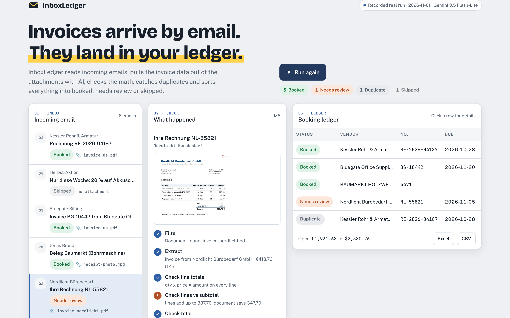

# InboxLedger

**Invoices arrive by email. They land in your ledger.**

InboxLedger reads incoming emails, pulls the invoice data out of PDF and image attachments with AI, checks the math with plain code, catches duplicates, and sorts every email into **booked**, **needs review**, **duplicate** or **skipped**. The result is a ledger in Excel or CSV, plus a full record of every decision.

**Live demo:** https://inboxledger-five.vercel.app



## What it does

| Step | What happens |
|---|---|
| **Filter** | Emails without a PDF or image are skipped, so newsletters never reach the AI. |
| **Extract** | Google Gemini returns vendor, document number, dates, line items, tax and totals as structured JSON (same engine as [DocDigest](https://github.com/Musaab20038/docdigest)). |
| **Verify** | Plain code recalculates quantity × price on every line, the line sum against the subtotal, and subtotal + tax against the total. A mismatch goes to review and never into the books. |
| **Dedupe** | A reminder email with the same invoice attached is recognised by vendor and number, so nothing is paid twice. |
| **Route & record** | Each email gets a status and a reason. The ledger is written to `ledger.xlsx` and `ledger.csv`, and every step is logged in `run.json`. |

## Result on the sample inbox

The sample inbox has six invented emails. The demo page replays this real run:

| Email | Result | Why |
|---|---|---|
| Supplier invoice (German PDF) | Booked | All checks passed |
| Newsletter | Skipped | No document attached |
| US invoice with discount, tax and shipping | Booked | All checks passed |
| Crooked receipt photo from an employee | Booked | All checks passed (VAT included in prices) |
| Office supplier invoice | **Needs review** | The supplier's own addition is wrong: lines add up to 337.70, invoice says 347.70 |
| Payment reminder with the first invoice re-attached | **Duplicate** | Same vendor and number as the first email |

## Run it

Requires Node.js 18 or newer and a Gemini API key.

```bash
npm install
export GEMINI_API_KEY=your-key
npm run run-inbox          # reads samples/inbox, writes out/ledger.xlsx, out/ledger.csv, out/run.json
```

Point it at any folder of `.eml` files: `node pipeline/run.js path/to/emails out`.

## Project layout

```
pipeline/run.js      email parsing, routing, ledger output
pipeline/checks.js   the math checks and duplicate key (no AI)
pipeline/extract.js  Gemini extraction with a strict JSON schema
samples/             the invented inbox and its attachments
public/              the demo page (static) and the recorded run
tools/make_inbox.py  builds the sample inbox
```

## Using it for a real business

The pipeline works on standard email files and writes a standard spreadsheet, so it fits around the tools a business already has:

- **Mailbox:** run it on a schedule against Gmail or Outlook, through an automation platform such as n8n or Activepieces, or a small script on the client's own account.
- **Destination:** Google Sheets, Excel, or an accounting tool such as Xero, where invoices are best created as *draft* bills so a person approves them.
- **Privacy:** use the paid Gemini API tier for client data (Google's terms require it for apps used in the EEA), and keep documents inside the client's own accounts.

These connectors are set up per client and are not part of this repository.

## Tech

Node.js · Google Gemini API (structured output) · mailparser · ExcelJS · static demo page on Vercel

## License

MIT
